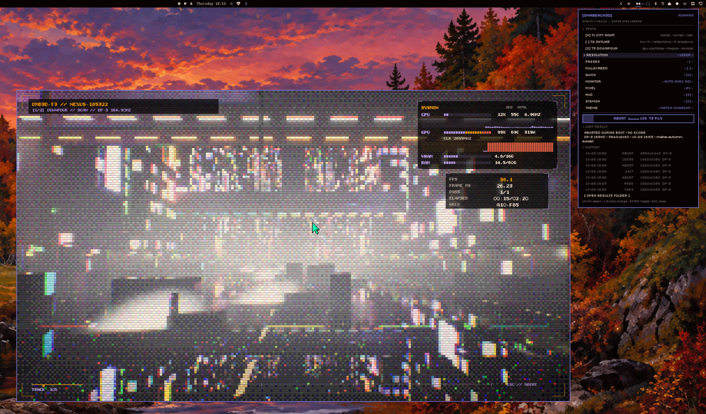
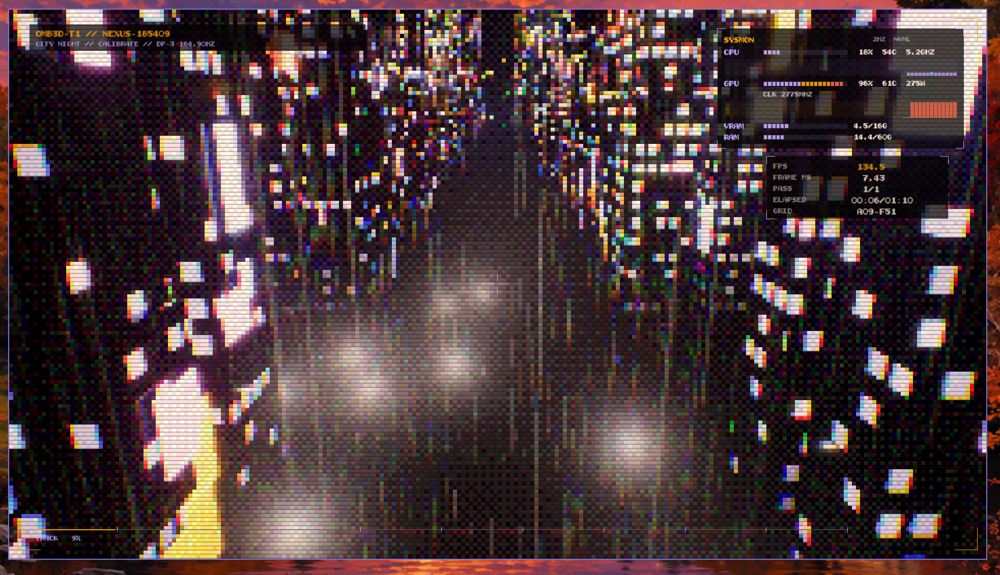
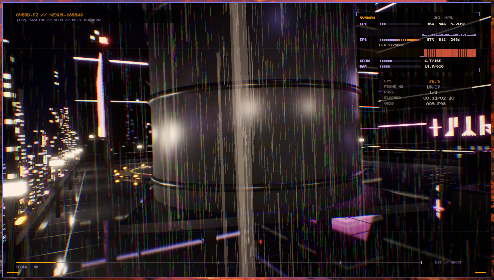
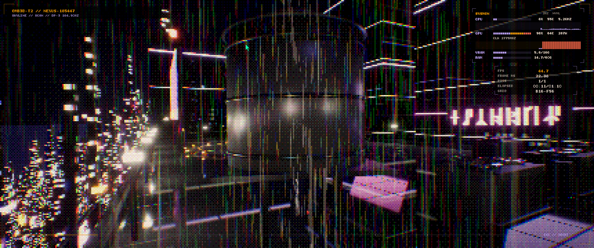

# omabench3d

UE5 GPU benchmark (T1 City Night, T2 Skyline, T3 Downpour) plus an Omarchy shell plugin (`plugin/`, id `io.github.lutzlstein.omabench3d`, CLI `plugin/bin/omabench3d-ctl`). Results: `~/.local/share/omabench3d/results`. Repo: https://github.com/lutzlstein/omabench3d

The UE project/module keep the internal name `OmaBench` (packaged launcher `Packaged/Linux/OmaBench.sh`).




| T1 City Night | T2 Skyline (rooftop) | T2 Skyline (wide) |
|---|---|---|
|  |  |  |

## Install (Omarchy 4)

Needs a Vulkan GPU driver (stock Omarchy ships `vulkan-icd-loader` + the NVIDIA/AMD/Intel ICD) and `curl`, `zstd`, `jq`
(all on stock Omarchy). Fonts and the Vulkan loader are bundled; the game links only glibc/libgcc.

```bash
omarchy plugin add https://github.com/lutzlstein/omabench3d --enable   # clones the repo, validates, places the bar widget
omarchy-shell shell rescanPlugins                                      # only if the icon does not appear
```

Then click the barbell icon → **INSTALL APP**: the plugin downloads `omabench3d-linux-x86_64.tar.zst` from the latest
GitHub Release, checks its `.sha256`, and unpacks it into `~/.local/share/omabench3d/app` (~660 MB). CLI equivalent:
`~/.config/omarchy/plugins/io.github.lutzlstein.omabench3d/plugin/bin/omabench3d-ctl install-app`
(`OMABENCH3D_RELEASE_URL=file:///path/to/omabench3d-linux-x86_64.tar.zst` installs a local tarball).
`appPath` defaults to `auto` (installed app, else a local `Packaged/` dev build).

Maintainers: `tools/package.sh` builds `Packaged/`, `tools/release.sh` builds `dist/*.tar.zst` + `.sha256`,
`tools/sync-manifest.sh` keeps the root `manifest.json` in step with `plugin/manifest.json`.

## Tests and scoring (v0.4)

| Test | Scene | RT profile (applied at runtime per test, recorded in `tests[].rtConfig`) |
|---|---|---|
| T1 City Night | rainy city flythrough | `hw-lumen-default`: HW Lumen GI+reflections, surface-cache lighting (`LightingMode 0`), screen traces on, max roughness 0.4, RT shadows off, translucency front-layer off |
| T2 Skyline | wet skyscraper rooftop in the City Night city: police spinner lands/lifts off, traffic, mirror-glass towers, rune neon | `hwrt-max`: HW Lumen, hit-lighting (`r.Lumen.HardwareRayTracing.LightingMode 2`), screen traces off, max roughness 0.6, translucency front-layer reflections on, `r.RayTracing.Shadows 1` (2 spp) |
| T3 Downpour | street market under two overpasses on the City Night avenue, in a storm; street-level 60 s walk | `hw-lumen-default` (same as T1) — the load is GPU compute + translucent overdraw, not RT |

### T3 Downpour: particle pipeline

All five systems are **Niagara GPU-compute sims**, generated from code by the `OmaFx` editor commandlet
(`Source/OmaBenchEditor/Private/OmaFxCommandlet.cpp`, run by `art/build.sh`) using UE 5.8's experimental
`UNiagaraExternalEditUtilities` API, so nothing is hand-authored in the editor.

| System | What | Default load (user param) |
|---|---|---|
| `NS_Rain` | velocity-aligned streaks in a 60x60x30 m box that follows the camera; killed on GPU depth-buffer collision | 400k/s spawn x 1.4 s life ≈ 500k+ live (`User.RainRate`) |
| `NS_Splash` | ground-plane droplets around the camera (bounce on depth buffer) | 120k/s x 0.35 s (`User.SplashRate`) |
| `NS_Sparks` | bursts from the failing rune sign (flicker synced to the sign's light), bounce on the street | 4k/s during bursts |
| `NS_Steam` x10 | curl-noise plumes from road vents, growing lit translucent puffs | 600/s each (`User.SteamRate`) |
| `NS_Smoke` | big lit, volumetric-lit translucent smoke sheets through the market (3D noise + depth fade per pixel) | 300/s x 9 s, 6.5 m sprites (`User.SmokeRate`) |

Determinism: every system has determinism on, a fixed random seed (101…505 + per-component seed offset),
a fixed 1/90 s sim tick and a fixed 3 s warmup; the camera path, sign flicker and spark bursts are pure
functions of path time. Splashes are spawned on the ground plane rather than from rain collision events
(GPU sims cannot emit events), so they are statistically, not drop-for-drop, linked to the rain.
Six patrol drones (Blender `SM_Drone`) are scripted actors, not particles: paired figure-eight
patrols with banking, sweeping volumetric searchlights and blinking nav lights, all functions of time.
Meshes (overpass, stalls, vents, drone) come from `art/blender/market.py`; sign text is invented runes.

`MaxReflectionBounces`/`MaxRefractionBounces` are requested too; cvars the engine lacks are listed in `rtConfig.unsupported` (on UE 5.8.4 both are absent).

Per-test score = 100 x avgFps x clamp(1 - frame-time CoV, 0.8, 1), median over passes. `scores.gpu` = geometric mean of the per-test scores (T1–T3 when all three run) (`scores.tests` has each). Multi-test runs: `-tests=T1,T2,T3` runs them in order, each with its own warmup and passes; progress.json carries `test`, `testIndex`, `testCount`, and a cumulative `elapsedS/totalS`.
